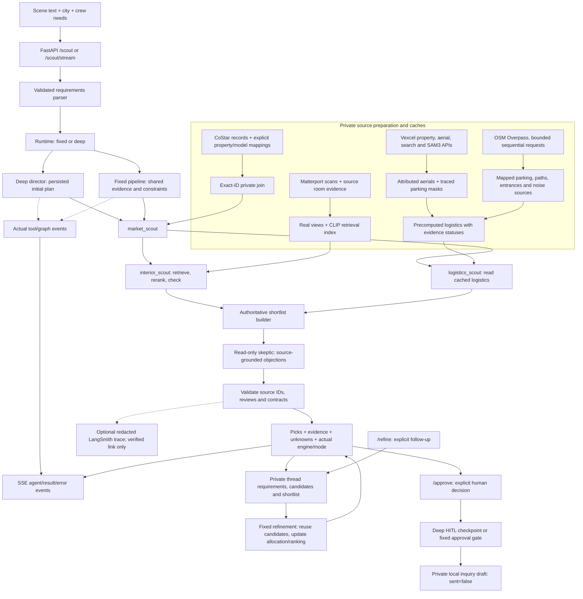

# Typecast architecture

Typecast joins a scene, actual interior views, exact property identity and cached crew logistics. The fixed engine and the `deepagents` director share source adapters, constraint checks and response contracts. The diagram below shows the deep path; the fixed path runs the same source/ranking stages in application code.

## What each layer decides

| Source | Supported evidence | Limit |
| --- | --- | --- |
| CoStar | Exact property/model mapping; city, type and recorded facts; marketed lease availability with explicit unknowns. | A listing does not establish filming permission, vacant occupancy or access. Nearest-address guesses are not joins. |
| Matterport | Actual camera frames, source scan identities and available room evidence; semantic retrieval and visual fit reasons. | Missing directional depth or ceiling measurements cannot become a verified physical fit. Scan navigation and camera-heading alignment are separate claims. |
| Vexcel | Attributed aerials, parcel containment checks, SAM3 mask-derived parking geometry and estimated area capacity. | Search tile footprints and detection rectangles are not parking boundaries. Parking rights, current occupancy and truck clearance remain unverified. |
| OSM supplement | Surface-parking polygons; walking only through an eligible mapped path and building-associated entrance; proximity to freeway, rail and airport/runway geometry. | Missing data stays unknown. Empty proximity results do not establish quiet; distance is not a sound measurement. |

Source downloads run before scouting. Runtime logistics reads normalized cache records and does not wait for Vexcel or Overpass. Credentials and all licensed source/derived files remain private. The public repository contains code, synthetic tests and aggregate evidence.

## Execution and human control

The deep director uses separate `market_scout`, `interior_scout`, `logistics_scout` and `skeptic` contexts. After the market pool returns, interior and logistics work in parallel. Tools keep exact retrieved IDs authoritative; the language model cannot replace the shortlist with invented properties. The skeptic can read the verified shortlist and object; it does not mutate source data.

The runtime bounds deep execution at 90 seconds and visibly falls back to fixed after ordinary failures or timeouts. A provider rate limit stops further model calls instead of retrying through fixed. Streaming uses actual events from the running work. The final response carries the engine and source mode that actually produced it. A configured or missing trace link is never proof of a successful trace; only verified links are exposed.

Follow-ups reuse the same retrieved candidate pool and apply explicit changed requirements. They can rerank cached views and reallocate parking without a new property/interior search. The current refinement engine is fixed, including after an initial deep run. Private thread memory has a six-hour process lifetime; restarting the server requires a new scout conversation. Saved files are not a durable graph-resume guarantee.

Deep approval uses an actual interrupted `draft_inquiry` tool checkpoint. `/approve` resumes it after an explicit decision. Fixed approval follows the application gate. Both save a local draft with `sent=false`; there is no owner-delivery claim in this flow.

## Evidence arithmetic and coverage

Parking uses `floor(area_m2 / 30)` car equivalents, with each truck consuming four equivalents from that same budget. Actual mask cells or mapped polygons determine the outline; holes are preserved. A connected mapped route is required for walking, rather than a line between centroids. See [Vexcel/OSM details](../data/VEXCEL.md).

The verified private index contains 10,568 views, 343 properties and 329 models. Every indexed property has a validated aerial, segmentation response, semantic-search response and OSM cache. There are 224 parking estimates, 128 properties with proximity flags, one estimated mapped walking route and 342 unknown walking distances. Five property-extract 404s leave parcel attributes unavailable. These counts describe cached source coverage, not successful bookings or a relevance score.

The frozen v1 visual stage reranked the existing first ten candidates. The selected default now scores twenty candidates in four validated five-image requests, with a concurrency limit of five, then ranks the full scored pool so later views can enter the top ten. The rest of the candidate pool remains available for refinement. An explicit setting can restore the 10/5/1 baseline. On five tune scenes and both engines, precision lower bound increased from 36% to 37%; the slowest selected deep request was 55.494 seconds. This is a small tune result, not a general accuracy claim. Evaluation scope, city ceilings and the separate post-tuning v2 test are in [the benchmark](team/eval.md). Demo timings are in [the pitch](pitch.md#numbers-the-presenter-can-defend).

## Implementation references

- API/runtime: `agent/app.py`, `agent/runtime.py`, `agent/interfaces.py`.
- Fixed evidence/ranking/refinement: `agent/pipeline.py`; validated source/response shapes: `contracts/schemas.py`.
- Director, delegates, plan and approval: `agent/deep.py`, `agent/deep_tools.py`, `agent/prompts/deep_*.md`.
- Retrieval/reranking: `index/search.py`, `index/store.py`, `agent/rerank.py`.
- Private sources: `data/build_join.py`, `data/costar_tools.py`, `data/vexcel_precompute.py`, `data/vexcel_geometry.py`, `data/vexcel_tools.py`.
- Private working memory and redacted tracing: `agent/state.py`, `agent/tracing.py`.

No Amazon, ChatOverflow or Photon integration is implied by this diagram. Their submission eligibility requires separate evidence.
